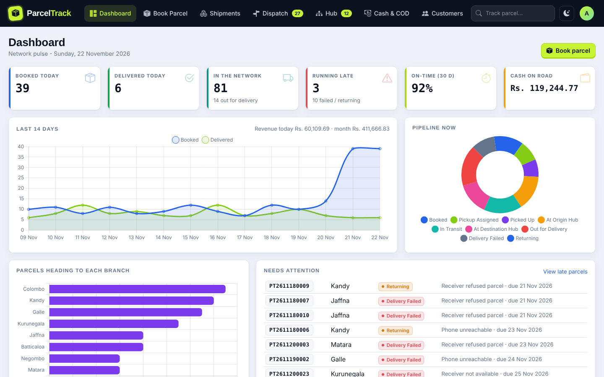
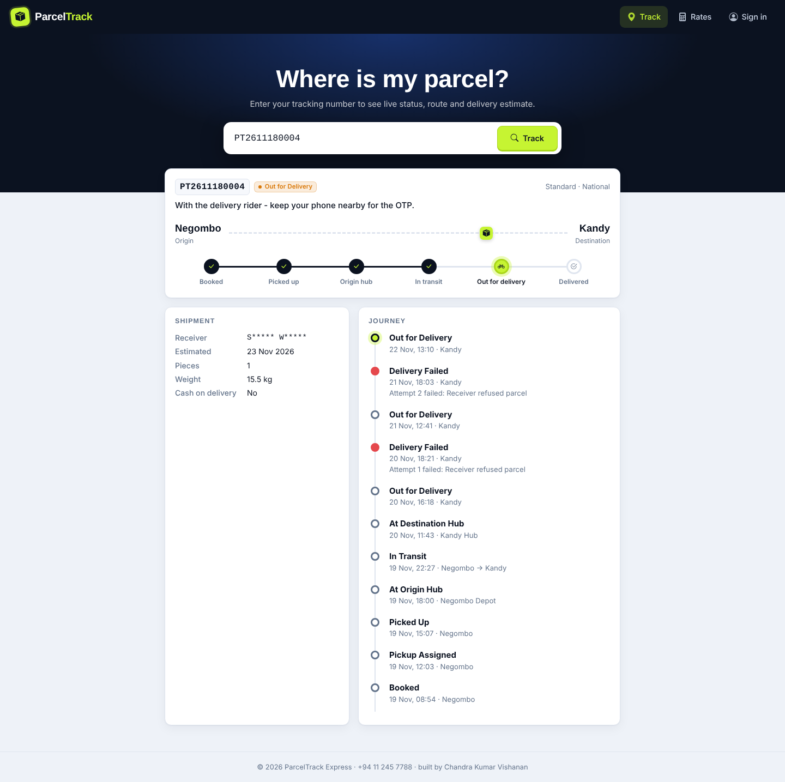
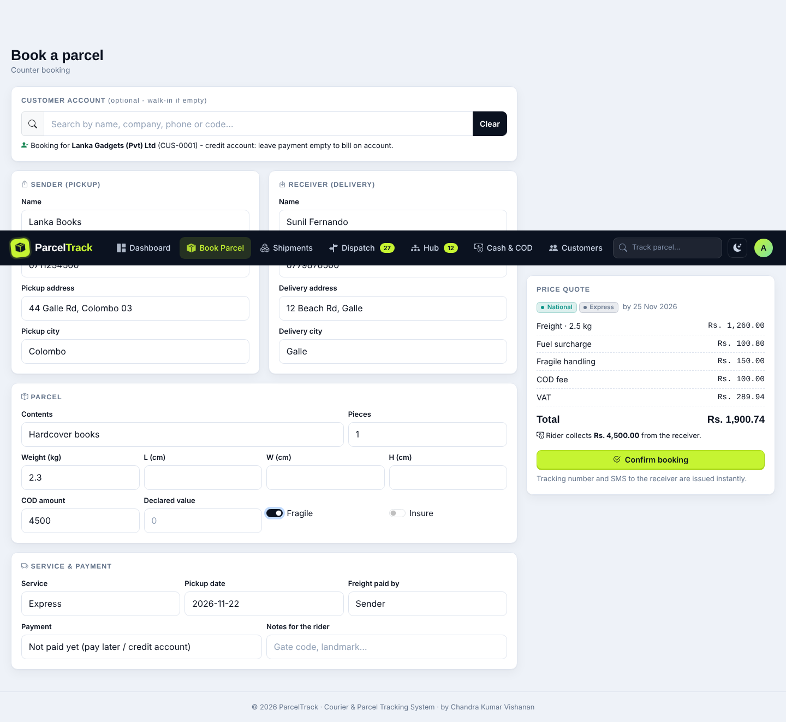
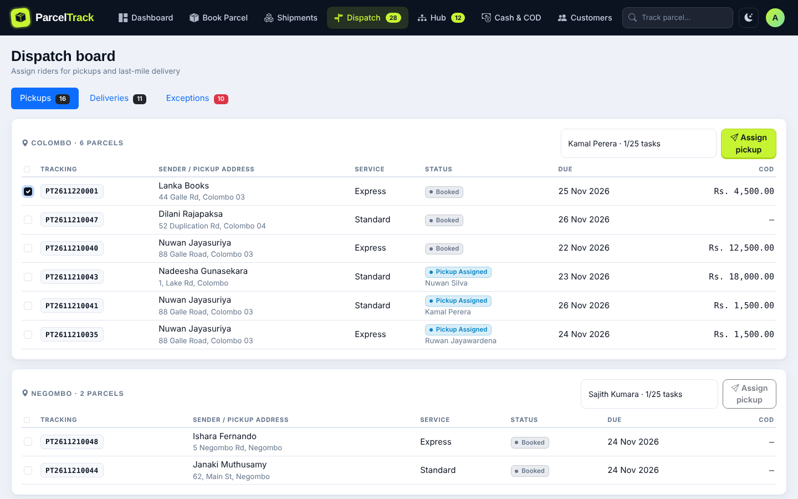
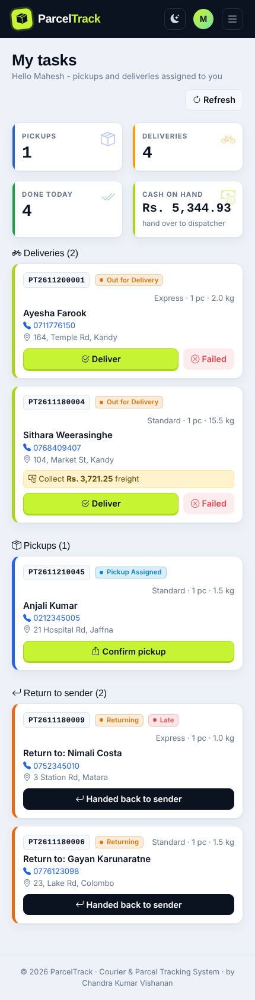
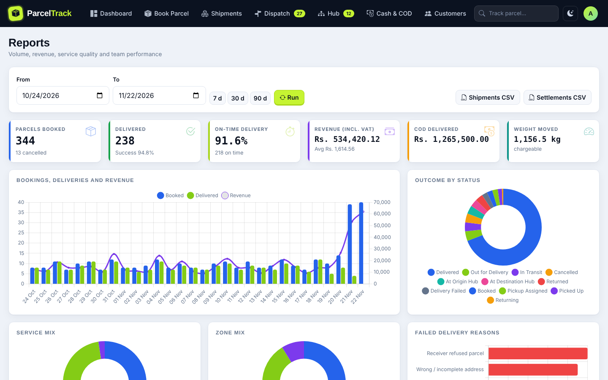
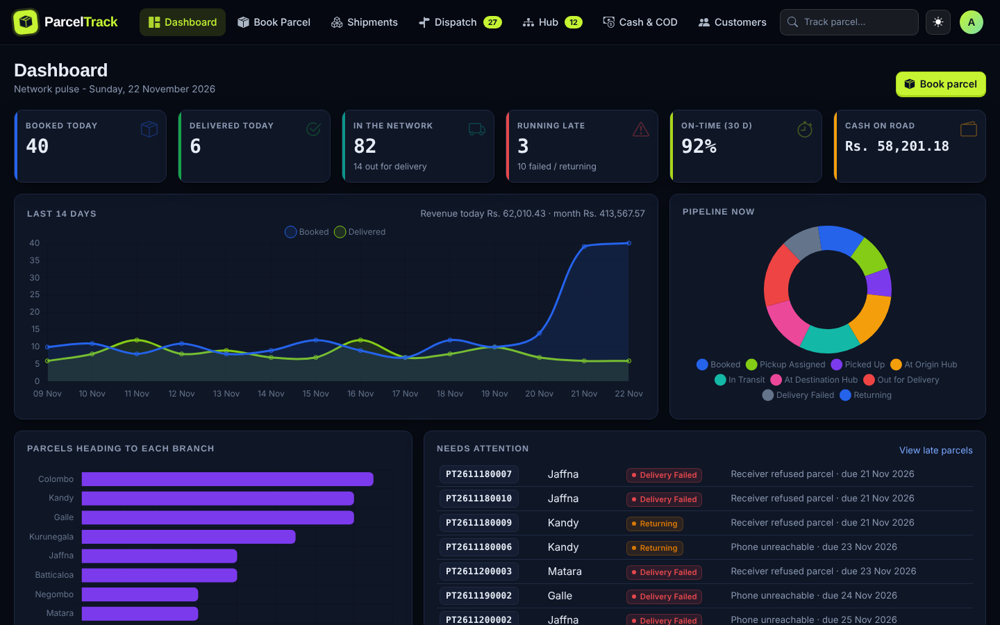

<div align="center">

# 📦 ParcelTrack

**Courier & Parcel Tracking System** — booking, pickup, hub sorting, linehaul manifests, OTP-verified delivery, COD cash settlement and public tracking.

   



</div>

## Overview

ParcelTrack models how a real courier company works across a branch network. A parcel is **booked**, **picked up** by a rider, **scanned in** at the origin hub, moved on a **manifest** (linehaul), **received** at the destination hub, handed to a delivery rider and **delivered with a 4-digit OTP**. Cash (COD and freight) collected on the road is tracked per rider and **settled** by the dispatcher.

Built with core PHP 8 + PDO, Bootstrap 5, vanilla JavaScript and FPDF. No framework, no build step.

## Screenshots

| Public tracking | Book a parcel | Dispatch board |
|---|---|---|
|  |  |  |

| Rider app (mobile) | Reports | Dark mode |
|---|---|---|
|  |  |  |

More in [`docs/screenshots/`](docs/screenshots).

## Features

- **Roles:** Admin, Dispatcher, Hub operator, Rider, Customer (portal) — plus a public tracking page and rate calculator.
- **Booking:** counter or online booking, live price quote, volumetric weight, COD, fragile, insurance, sender/receiver pays.
- **Dispatch:** assign pickup and delivery riders per branch; rider capacity (25 active tasks) and branch rules enforced.
- **Hub:** scan-in by tracking number, build manifests per destination, dispatch, receive (partial receives allowed).
- **Rider app:** mobile-first task list, pickup with cash collection, **OTP delivery**, failed-delivery reasons, return to sender.
- **Cash:** every COD / freight rupee collected is recorded per rider; the dispatcher settles it against a counted amount that must match exactly.
- **Public tracking** (`/track`): stepper, route and timeline, with receiver details masked.
- **Reports:** volume, revenue, on-time %, service/zone mix, failed reasons, branch throughput, rider performance, CSV export.
- **Admin:** branches, rate cards, staff, audit log, simulated SMS outbox.
- **PDFs:** A6 shipping label with Code 39 barcode, A4 waybill/invoice.
- **Security:** PDO prepared statements, CSRF tokens, password hashing, role guards on pages *and* APIs, login lockout, audit trail, CSV formula-injection guard.

## Status workflow

```
Booked → Pickup Assigned → Picked Up → At Origin Hub → In Transit → At Destination Hub → Out for Delivery → Delivered
                                                                                     ↘ Delivery Failed → (retry | Returning → Returned)
Booked / Pickup Assigned → Cancelled (payment refunded)
```
Local (same-city) parcels skip *In Transit*. After **3 failed attempts** a parcel goes to *Returning*; a receiver-pays freight bill then switches to the sender. After **5 wrong OTP entries** delivery locks until a dispatcher re-issues the code.

## Pricing formulas

All prices come from one function, `Pricing::quote()`.

| Item | Rule |
|---|---|
| Chargeable weight | `max(actual kg, L×W×H ÷ 5000)`, rounded **up** to the next 0.5 kg (min 0.5) |
| Freight | `base_price + (chargeable − included_kg) × per_extra_kg` from the rate card (service × zone) |
| Fuel surcharge | 8 % of freight |
| Fragile fee | Rs. 150 |
| COD fee | `max(Rs. 100, 2 % of COD)` when COD > 0 |
| Insurance | 1 % of declared value, if insured |
| **VAT** | **18 % on (freight + fuel + fragile + COD fee + insurance)** |
| **Total** | sum of the above + VAT |

Zones: **Local** = same branch city, **Regional** = same region, **National** = different region. Same-day is Local only. Limits: 50 kg, COD ≤ Rs. 500,000. Rates seeded:

| Service | Local | Regional | National |
|---|---|---|---|
| Standard | 350 (+90/kg) · 2 d | 450 (+120/kg) · 3 d | 600 (+160/kg) · 5 d |
| Express | 550 (+140/kg) · 1 d | 700 (+180/kg) · 2 d | 900 (+240/kg) · 3 d |
| Same-day | 1,200 (+250/kg) · same day | – | – |

Edit rates in **Admin → Rate cards**; percentages and fees live in `config/config.php`.

## Troubleshooting (dashboard / blank page / 404)

Open `http://localhost/<your-folder>/check.php` - it tests the PHP version (8.0+, 8.1+ recommended), extensions, database import, URL rewriting and the CDN, and tells you what to fix. Delete `check.php` afterwards.

- **404 after login** - enable `rewrite_module` in WAMP and set `AllowOverride All` for the `www` folder. The folder name no longer matters (`APP_BASE` is auto-detected).
- **Database error** - import `sql/database.sql`; if MariaDB runs on 3307, change `DB_PORT` in `config/config.php`.
- **KPIs show but charts are missing** - the page loads Chart.js/Bootstrap from a CDN, so it needs internet access.

## Demo logins

| Role | Username | Password |
|---|---|---|
| Admin | `admin` | `admin123` |
| Dispatcher | `dispatcher1`, `dispatcher2` | `dispatch123` |
| Hub operator | `hub1` … `hub4` | `hub123` |
| Rider | `rider1` … `rider10` | `rider123` |
| Customer | `customer1` … `customer6` | `customer123` |

`customer1` and `customer3` are credit accounts. The seed holds 8 branches, 450 shipments in every status, 180+ manifests and rider cash/settlement history.

## Installation (WAMP)

1. Copy the folder to `C:/wamp64/www/parcel_track`.
2. Start WAMP, open **phpMyAdmin → Import** and import `sql/database.sql` (it creates the `parcel_track` database).
3. Check `config/config.php` (`DB_USER`/`DB_PASS`/`DB_PORT`; `APP_BASE` is `/parcel_track`).
4. Enable `mod_rewrite` (WAMP tray → Apache → Apache modules) and make sure `AllowOverride All` is on for `www`.
5. Open <http://localhost/parcel_track/> and sign in.

Fonts and libraries (Bootstrap, DataTables, Chart.js, flatpickr) load from CDNs, so the browser needs internet access.

## Tests

```bash
# fresh DB first (re-import sql/database.sql), then:
python3 tests/e2e_lifecycle.py          # 100+ business-rule checks over HTTP (needs: pip install requests)
php tests/check_seed_pricing.php        # recompute every stored price with Pricing::quote()
npm i playwright && npx playwright install chromium
node tests/ui_test.js                   # drives the UI and regenerates docs/screenshots/
```
Set `BASE`, `MYSQL` (e.g. `"C:/wamp64/bin/mysql/.../mysql.exe -uroot"`) and `DB_NAME` if your setup differs.

## Project structure

```
config/      settings + PDO connection
includes/    auth, layout, helpers, models (Pricing, ShipmentModel, ManifestModel, CodModel …)
modules/     shipments · hub · rider · cod · customers · reports · admin · track · rates · dashboard
assets/      css (navy + lime theme, dark mode), js
sql/         database.sql (schema + seed)
tests/       API, pricing and UI tests
lib/fpdf/    PDF library
```

## Before going live

- Set `APP_DEBUG` to `false` in `config/config.php`.
- Remove the demo-accounts box from `login.php` and change every seeded password.
- Login lockout is session-based; add IP-based throttling at the proxy for production.
- SMS is simulated (`sms_log`); connect a gateway in `ShipmentModel::textTo()`.

## Author

**Chandra Kumar Vishanan**
HND in Information Technology (HNDIT) – SLIATE

## License

[MIT]
